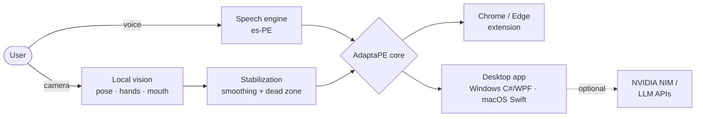

<div align="center">
  

  

  <br/>

  <a href="https://www.adaptape.cc/"></a>
  <a href="https://www.thealejo-dev.cc/"></a>
  <a href="mailto:thealejodeveloper@gmail.com"></a>
  

  <br/>

  
  
  
</div>

---

## 👨‍💻 About me / Sobre mí

<table>
<tr>
<td width="50%" valign="top">

**🇺🇸 English**

Software Engineering student from Lima, Peru, building **real products that ship**. I integrate **AI into software** — LLMs, multimodal vision and speech — and I work across the whole stack: web, native iOS/Android, desktop apps and my own Linux **HomeLab**.

My main project is **[AdaptaPE](https://www.adaptape.cc/)**, an accessibility suite that lets people with visual or motor difficulties use their browser and PC with **voice, colors and body movement**.

I also tinker with **electronics**: ESP32/Arduino prototypes and hands-on repair of PCBs, iPhones, consoles and controllers.

</td>
<td width="50%" valign="top">

**🇪🇸 Español**

Estudiante de Ingeniería de Software en Lima, Perú, construyendo **productos reales en producción**. Integro **IA en software** — LLMs, visión multimodal y voz — y trabajo en todo el stack: web, apps nativas iOS/Android, escritorio y mi propio **HomeLab** Linux.

Mi proyecto principal es **[AdaptaPE](https://www.adaptape.cc/)**, una suite de accesibilidad que permite usar el navegador y la PC con **voz, colores y movimiento del cuerpo** a personas con dificultades visuales o motoras.

También trabajo con **electrónica**: prototipos ESP32/Arduino y reparación de PCBs, iPhones, consolas y mandos.

</td>
</tr>
</table>

```yaml
focus:      [AI + Vision, Multiplatform apps, Self-hosted infra, IoT & Hardware]
open_to:    [Internships, Software / Full-Stack roles, Native mobile, Freelance, Open Source]
languages:  [Español (native), English]
next:       Data Science & AI Engineering
```

---

## ⭐ Flagship project — AdaptaPE

<div align="center">
  <a href="https://www.adaptape.cc/">
    
  </a>
  <br/><br/>
  <a href="https://www.adaptape.cc/"></a>
  <a href="https://adaptape.thealejo-dev.cc/"></a>
  <a href="https://github.com/TheAlejo160/Adapta-PE"></a>
  <br/>
  
  
  
  
</div>

<br/>

**Accessibility suite made in Peru** for people with visual, motor or involuntary-movement difficulties. Software Engineering thesis project, **in production** as a browser extension (Chrome Web Store) and desktop app. I'm the **creator & lead developer**.

| Feature | What it does |
| :--- | :--- |
| 🎙️ **Voice assistant (es-PE)** | Wake word *"Computadora"* → scroll, search, click, dictate, zoom, control tabs. Browser or local speech mode. |
| 🎨 **7 color-blind filters** | Protan/deuter/tritan (‑anomaly and ‑anopia) + achromatopsia, built with SVG color matrices. |
| 🔊 **Contextual reader (TalkBack)** | Reads buttons and links on hover or Tab with local Spanish voices. |
| 🖱️ **Kinetic Mouse** | Moves the pointer with the camera: head/torso, arms/hands/fists or residual limb. **Frames are processed locally, never stored or sent.** |
| 🫱 **Gestures** | Point to move, fist to stop, pinch for left/right click, open mouth to click. |
| 🧘 **Motion stabilization** | Smoothing + central dead zone to reduce small involuntary movements and tremors. |
| ⏱️ **Dwell Click** | Clicks after holding still on a target for 1 second. |



**Stack:** `C#/WPF` `Swift` `Apple Vision` `JavaScript` `Chrome Extensions (MV3)` `Web Speech API` `SVG filters` `NVIDIA NIM` `Cloudflare`

**Ecosystem:** 8-lesson interactive tutorial · live demo · mascots (Tinku, Cuchu, Yati) · enterprise licensing for institutions and hospitals · collaborations with AnatoMix3D and Psicogame.
**Research roadmap:** local AI (AdaptaPE‑AI), *Ojo Biónico* computer vision, eye tracking and EEG brain-computer interfaces.

---

## 🚀 Other projects

<table>
<tr>
<td width="50%" valign="top">

### ☁️ TheAlejoCloud
Private cloud with **native iOS and Android apps** connected to my Linux server. Multi-user file access to a self-hosted HomeLab.

`Swift` `SwiftUI` `Kotlin` `Linux` `CasaOS` `FileBrowser` `Cloudflare Tunnels`

[](https://github.com/TheAlejo160/TheAlejoCloud-iOS)

</td>
<td width="50%" valign="top">

### 🏠 Family Hub
Full-stack home dashboard: finances, tasks, calendars and shortcuts to NAS services, running 24/7 on my HomeLab.

`Next.js` `React` `TypeScript` `Tailwind CSS` `SQLite` `PM2`

[](https://www.thealejo-dev.cc/)

</td>
</tr>
<tr>
<td width="50%" valign="top">

### ⚔️ TeroGenshin (GenshinMode)
Minecraft plugin (1.17 → 1.19.4+) that recreates **Genshin Impact elemental reactions**: concurrent elemental states, RPG combat and multi-language support. Published on SpigotMC.

`Java` `Spigot/Paper API` `OOP` `Concurrency` `Maven`

[](https://github.com/TheAlejo160/TeroGenshin)

</td>
<td width="50%" valign="top">

### 🪙 TeroCoinFlip
Betting & economy plugin for Paper servers with GUI menus, **race-condition protection** and persistent data.

`Java` `Paper API` `Vault API` `Async I/O` `Maven`

</td>
</tr>
<tr>
<td width="50%" valign="top">

### 🏰 TempleCraft · TeroCraft · ComuGamers
Founder / co-owner and technical lead of multiplayer server networks: self-hosted on Linux, custom Java plugins, JVM memory tuning, scheduled tasks and game balance.

`Java` `Linux` `JVM tuning` `Networking` `Automation`

</td>
<td width="50%" valign="top">

### 🔌 IoT & Hardware Lab
C++ prototypes on **ESP32/Arduino** (incl. Bluetooth HID controller emulation) integrated with my server. Diagnosis and repair of **PCBs, iPhones, consoles and controllers**.

`ESP32` `Arduino` `C++` `Bluetooth HID` `PCB diagnostics`

</td>
</tr>
</table>

---

## ⚙️ Tech stack

**Languages**
<p>
  
</p>

**Web, mobile & desktop**
<p>
  
  <br/>
  
  
  
  
</p>

**AI & data**
<p>
  
  
  
  
  
  
  <br/>
  <sub>Learning: Python · pandas · NumPy · scikit-learn · Jupyter</sub>
</p>

**Databases, infra & hardware**
<p>
  
  <br/>
  
  
  
  
</p>

**Tools & OS**
<p>
  
  
</p>

---

## 📊 GitHub stats

<div align="center">
  
  
  <br/>
  
  <br/>
</div>

<div align="center">
  <picture>
    <source media="(prefers-color-scheme: dark)" srcset="https://raw.githubusercontent.com/TheAlejo160/TheAlejo160/output/github-contribution-grid-snake-dark.svg">
    <source media="(prefers-color-scheme: light)" srcset="https://raw.githubusercontent.com/TheAlejo160/TheAlejo160/output/github-contribution-grid-snake.svg">
    
  </picture>
</div>

---

## 🎯 Right now

```yaml
building:
  - AdaptaPE Pro & Linux client
  - AdaptaPE-AI (local AI) and "Ojo Biónico" computer vision research
learning:
  - Data Science & ML with Python
  - Advanced native iOS (Swift / SwiftUI)
looking_for:
  - Internships and Software / Full-Stack roles
  - Freelance projects — web, mobile, AI integration
  - Open Source collaboration on accessibility
```

<div align="center">
  <br/>
  <b>Let's build something that adapts to people. / Construyamos tecnología que se adapte a las personas.</b>
  <br/><br/>
  <a href="mailto:thealejodeveloper@gmail.com"></a>
  <br/><br/>
  
</div>
