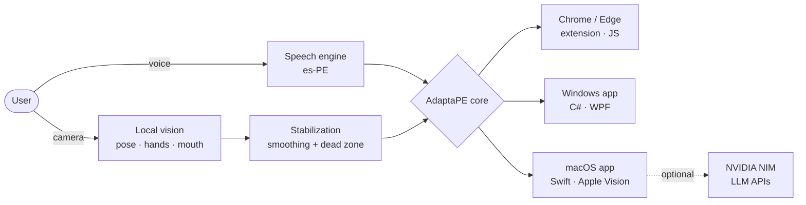

<div align="center">




<br/>

<a href="https://www.adaptape.cc/"></a>
<a href="https://www.thealejo-dev.cc/"></a>
<a href="mailto:thealejodeveloper@gmail.com"></a>
<a href="https://orcid.org/0009-0009-7231-9153"></a>

<br/>


</div>

---

## 👨‍💻 About me · Sobre mí

<table>
<tr>
<td width="50%" valign="top">

**🇺🇸 English**

Software Engineering student from Lima, Peru, building **real products that ship**. I integrate **AI into software** — LLMs, multimodal vision and speech — and work across the whole stack: web, native iOS/Android, Windows/macOS desktop apps and my own Linux **HomeLab**.

My main project is **[AdaptaPE](https://www.adaptape.cc/)**: an accessibility suite, in production, that lets people with visual or motor difficulties use their browser and PC with **voice, colors and body movement**.

Outside software I work with **electronics**: ESP32/Arduino prototypes and hands-on diagnosis and repair of PCBs, iPhones, consoles and controllers.

</td>
<td width="50%" valign="top">

**🇪🇸 Español**

Estudiante de Ingeniería de Software en Lima, Perú, construyendo **productos reales en producción**. Integro **IA en software** — LLMs, visión multimodal y voz — y trabajo en todo el stack: web, apps nativas iOS/Android, escritorio Windows/macOS y mi propio **HomeLab** Linux.

Mi proyecto principal es **[AdaptaPE](https://www.adaptape.cc/)**: una suite de accesibilidad, en producción, que permite usar el navegador y la PC con **voz, colores y movimiento del cuerpo** a personas con dificultades visuales o motoras.

Fuera del software trabajo con **electrónica**: prototipos ESP32/Arduino y diagnóstico y reparación de PCBs, iPhones, consolas y mandos.

</td>
</tr>
</table>

> **Open to / Abierto a:** internships · Software and Full-Stack roles · native mobile (iOS/Android) · AI integration · freelance projects · open-source accessibility.

---

## ⭐ Flagship project — AdaptaPE

<div align="center">

<a href="https://www.adaptape.cc/"></a>

<a href="https://www.adaptape.cc/"></a>
<a href="https://adaptape.thealejo-dev.cc/"></a>
<a href="https://github.com/TheAlejo160/Adapta-PE"></a>


</div>

**Accessibility suite made in Peru** for people with visual, motor or involuntary-movement difficulties. Software Engineering thesis project, shipped as a **Chrome Web Store extension** and native **Windows and macOS** apps. I'm the **creator and lead developer**.

| | Feature | What it does |
| :---: | :--- | :--- |
| 🎙️ | **Voice assistant (es-PE)** | Wake word *"Computadora"*: scroll, search, click, dictate, zoom, control tabs. Browser or local speech mode. |
| 🎨 | **7 color-blind filters** | Protan / deuter / tritan (‑anomaly and ‑anopia) plus achromatopsia, built with SVG color matrices. |
| 🔊 | **Contextual reader** | Reads buttons and links on hover or Tab with local Spanish voices. |
| 🖱️ | **Kinetic Mouse** | Moves the pointer with the camera: head/torso, arms/hands/fists or residual limb. **Frames are processed locally, never stored or sent.** |
| ✋ | **Gestures** | Point to move, fist to stop, pinch for left/right click, open mouth to click. |
| 🧘 | **Motion stabilization** | Smoothing and a central dead zone to reduce tremors and small involuntary movements. |
| ⏱️ | **Dwell Click** | Clicks after holding still on a target for 1 second. |



<details>
<summary><b>📦 AdaptaPE repositories and editions</b></summary>
<br/>

| Repository | Platform | Stack |
| :--- | :--- | :--- |
| [Adapta-PE](https://github.com/TheAlejo160/Adapta-PE) | Chrome / Edge extension (full) | JavaScript |
| [Adapta-PE-Lite](https://github.com/TheAlejo160/Adapta-PE-Lite) | Chrome / Edge extension (Lite) | JavaScript |
| [Adapta-PE-Win](https://github.com/TheAlejo160/Adapta-PE-Win) | Windows x64 (full) | C# · WPF |
| [Adapta-PE-Lite-Win](https://github.com/TheAlejo160/Adapta-PE-Lite-Win) | Windows x64 (Lite) | C# · WPF |
| [Adapta-PE-MacOS](https://github.com/TheAlejo160/Adapta-PE-MacOS-Intel-Apple-Silicon-) | macOS Intel + Apple Silicon (full) | Swift |
| [Adapta-PE-Lite-MacOS](https://github.com/TheAlejo160/Adapta-PE-Lite-MacOS) | macOS (Lite) | Swift |

**Editions:** Lite (free) · AdaptaPE (free for personal use, commercial license for organizations) · Pro and Pro Deluxe (in development).
**Ecosystem:** 8-lesson interactive tutorial · live demo · mascots Tinku, Cuchu and Yati · enterprise licensing for institutions and hospitals · collaborations with AnatoMix3D and Psicogame.
**Research roadmap:** local AI (AdaptaPE‑AI), *Ojo Biónico* computer vision, eye tracking and EEG brain-computer interfaces.

</details>

---

## 🚀 Featured projects

<div align="center">
<a href="https://github.com/TheAlejo160/Adapta-PE"></a>
<a href="https://github.com/TheAlejo160/Adapta-PE-MacOS-Intel-Apple-Silicon-"></a>
<a href="https://github.com/TheAlejo160/TheAlejoCloud-iOS"></a>
<a href="https://github.com/TheAlejo160/TheAlejoCloud-Android"></a>
<a href="https://github.com/TheAlejo160/Adapta-PE-Win"></a>
<a href="https://github.com/TheAlejo160/TeroGenshin"></a>
</div>

<br/>

<details>
<summary><b>☁️ TheAlejoCloud — native iOS and Android private cloud</b></summary>
<br/>

Self-hosted cloud with **two fully native apps** that connect to my Linux server (CasaOS + FileBrowser). Built for a HomeLab, designed so it can grow into a multi-user product.

| | |
| :--- | :--- |
| **Stack** | Swift · SwiftUI · Kotlin · Linux · CasaOS · FileBrowser · Cloudflare Tunnels |
| **What I built** | iOS and Android clients, server setup, secure remote access through Cloudflare Tunnels |
| **Repos** | [TheAlejoCloud-iOS](https://github.com/TheAlejo160/TheAlejoCloud-iOS) · [TheAlejoCloud-Android](https://github.com/TheAlejo160/TheAlejoCloud-Android) |

</details>

<details>
<summary><b>🏠 Family Hub — full-stack HomeLab dashboard</b></summary>
<br/>

Web panel for home use: finances, tasks, calendars and shortcuts to NAS services. Runs 24/7 on my HomeLab, managed with PM2.

| | |
| :--- | :--- |
| **Stack** | Next.js · React · TypeScript · Tailwind CSS · SQLite · PM2 |
| **What I built** | Type-safe UI, local data storage, deployment on my own Linux server |
| **Live** | [thealejo-dev.cc](https://www.thealejo-dev.cc/) |

</details>

<details>
<summary><b>⚔️ TeroGenshin — Genshin Impact combat for Minecraft</b></summary>
<br/>

Minecraft plugin (1.17 → 1.19.4+) that recreates **Genshin Impact elemental reactions**: concurrent elemental states, RPG combat and multi-language support. Published on SpigotMC.

| | |
| :--- | :--- |
| **Stack** | Java · Spigot/Paper API · OOP · Concurrency · Maven |
| **Repo** | [TeroGenshin](https://github.com/TheAlejo160/TeroGenshin) |

</details>

<details>
<summary><b>🪙 TeroCoinFlip and other Paper plugins</b></summary>
<br/>

Betting and economy plugin for Paper servers with GUI menus, **race-condition protection** and persistent data. Also custom RPG item and staff/MMO plugins for my own networks.

| | |
| :--- | :--- |
| **Stack** | Java · Paper API · Vault API · Async I/O · Maven |

</details>

<details>
<summary><b>🔌 IoT and Hardware Lab</b></summary>
<br/>

C++ prototypes on **ESP32/Arduino**, including Bluetooth HID controller emulation, integrated with my HomeLab. Hands-on diagnosis and repair of **PCBs, iPhones, consoles and controllers**.

| | |
| :--- | :--- |
| **Stack** | ESP32 · Arduino · C++ · Bluetooth HID · PCB diagnostics |

</details>

---

## ⚙️ Tech stack

<table>
<tr>
<td align="center" width="140"><b>Languages</b></td>
<td></td>
</tr>
<tr>
<td align="center"><b>Web</b></td>
<td></td>
</tr>
<tr>
<td align="center"><b>Mobile and desktop</b></td>
<td>
<br/>


</td>
</tr>
<tr>
<td align="center"><b>AI</b></td>
<td>


</td>
</tr>
<tr>
<td align="center"><b>Data</b><br/><sub>learning</sub></td>
<td>


</td>
</tr>
<tr>
<td align="center"><b>Databases</b></td>
<td></td>
</tr>
<tr>
<td align="center"><b>Infra and DevOps</b></td>
<td>
<br/>


</td>
</tr>
<tr>
<td align="center"><b>Hardware</b></td>
<td>
<br/>


</td>
</tr>
<tr>
<td align="center"><b>IDEs and OS</b></td>
<td>
<br/>


</td>
</tr>
</table>

---

## 🧠 Knowledge areas

| Area | What I do / Qué hago |
| :--- | :--- |
| 🤖 **AI integration** | LLM APIs, prompt engineering, multimodal vision (NVIDIA NIM, LLaMA Vision, Apple Vision), speech STT/TTS in Spanish. |
| 👁️ **Computer vision** | Local, real-time pose, hand and mouth tracking for camera-driven pointer control in AdaptaPE. |
| ♿ **Accessibility** | Assistive input (voice, gestures, dwell click), color-vision filters, motion stabilization, screen reading. |
| 📱 **Native apps** | iOS/macOS with Swift and SwiftUI, Android with Kotlin, Windows with C# and WPF. |
| 🌐 **Full-stack web** | Next.js, React, TypeScript, Node.js, SQL databases, browser extensions. |
| 🖥️ **Self-hosting** | Linux HomeLab, CasaOS, PM2, Cloudflare Tunnels, JVM tuning for game servers. |
| 🔧 **Electronics** | ESP32/Arduino firmware in C++, Bluetooth HID, PCB diagnosis and device repair. |

---

## 💼 Experience

| Role | Project / Network | Period |
| :--- | :--- | :--- |
| **Creator and Lead Developer** | [AdaptaPE](https://www.adaptape.cc/) — accessibility suite | *Current* |
| **Freelance Software Developer** | Independent clients — web, mobile, AI integration | *Current* |
| **HomeLab Administrator** | TheAlejoCloud · Family Hub — Linux, CasaOS, PM2 | *Current* |
| **Hardware Technician** | PCB, iPhone, console and controller repair | *Current* |
| **Founder and Lead Developer** | TempleCraft Network — self-hosted Minecraft server | *Previous* |
| **Co-owner and Technical Lead** | TeroCraft · ComuGamers — multiplayer networks | *Previous* |

---

## 🏆 Highlights

| | |
| :---: | :--- |
| 🚀 | **AdaptaPE in production** on Chrome Web Store, Windows and macOS (Intel and Apple Silicon) — 6 public repositories across 3 platforms. |
| 🇵🇪 | **Accessibility made in Peru** — Spanish (es-PE) voice control, with camera frames processed on-device for privacy. |
| ☁️ | **Own cloud with native clients** — iOS and Android apps over a self-hosted Linux server. |
| ⚔️ | **Published Minecraft plugin** — TeroGenshin on SpigotMC, plus custom plugins for networks I founded or co-ran. |
| 🔧 | **Software and hardware** — from C++ on ESP32 to repairing PCBs and iPhones. |

---

## 📊 GitHub stats

<div align="center">


<br/>

<br/><br/>
<picture>
  <source media="(prefers-color-scheme: dark)" srcset="https://raw.githubusercontent.com/TheAlejo160/TheAlejo160/output/github-contribution-grid-snake-dark.svg">
  <source media="(prefers-color-scheme: light)" srcset="https://raw.githubusercontent.com/TheAlejo160/TheAlejo160/output/github-contribution-grid-snake.svg">
  
</picture>
</div>

---

## 🎯 Right now

```yaml
building:
  - AdaptaPE Pro and the Linux client
  - AdaptaPE-AI (local AI) and "Ojo Biónico" computer vision research
learning:
  - Data Science and Machine Learning with Python
  - Advanced native iOS (Swift / SwiftUI)
looking_for:
  - Internships and Software / Full-Stack roles
  - Freelance projects: web, mobile, AI integration
  - Open-source collaboration on accessibility
```

<div align="center">

**Let's build technology that adapts to people. · Construyamos tecnología que se adapte a las personas.**

<a href="mailto:thealejodeveloper@gmail.com"></a>
<a href="https://www.thealejo-dev.cc/"></a>


</div>
